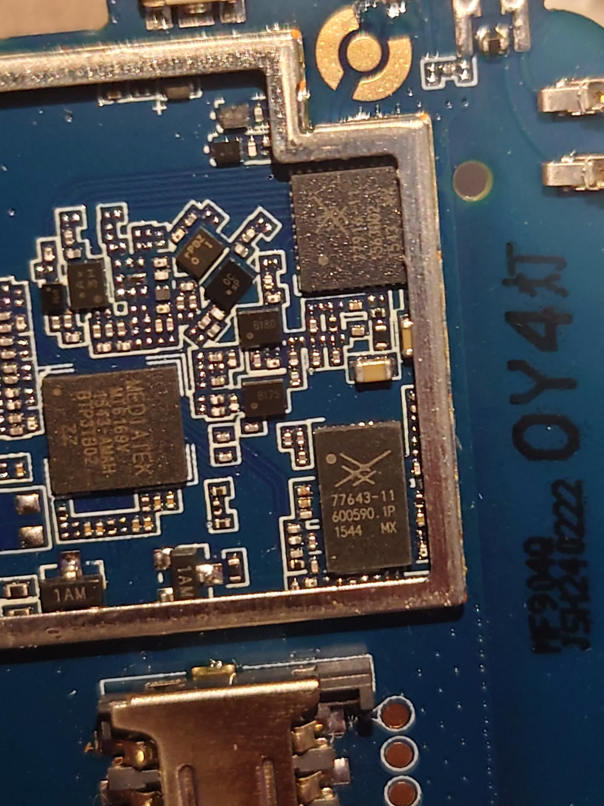

# Reviewed real-device photo

> Source review25October2026:50 reviewed historical source/build files are now included under per-file terms;24 GPL-scoped components retain upstream notices,26 independent/factual files have no new blanket license. probe_v3.S is withheld. Vendor binaries and private inputs are absent; no runnable live-tool or full LK rebuild claim. See repository-root LICENSE_REVIEW.md.

**Caption:** Historical close-up of the owner's modem PCB, showing component packages, RF shielding boundaries and board traces. It supports the existence of the photographed hardware and component layout. It does not identify UART TX/RX/GND, demonstrate a physical unlock connection, show a bootloader state, or prove Arabic LCD output.

The image was visually reviewed; no IMEI, SIM identity, account credential, Wi-Fi key or device serial label appears in this selected frame. JPEG APP1–APP15/comment metadata was removed without regenerating the compressed image scan. This is a privacy publication derivative, not an AI-generated or retouched evidence image. The private original remains unchanged outside this repository.

Only this photo was cleared for this package. Exterior/label, actual Arabic LCD, WebUI, recovery and network screenshots were not automatically copied. Some exist privately; they require individual visual redaction/review. No missing photo is substituted with a mockup or another device.
